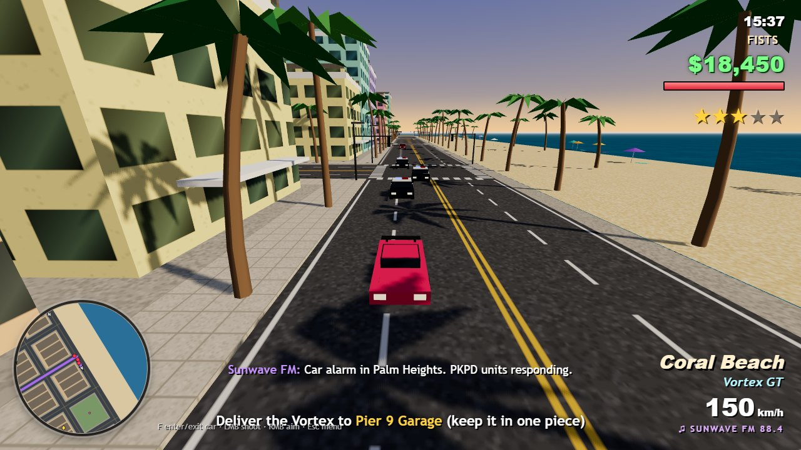

# Palmera Heat

[](https://make.fun/c/gta6-01)
[](https://make.fun/c/gta6-01)
[](https://make.fun/c/gta6-01)

An original open-world crime game for the browser, made for make.fun's **Make GTA 6** bounty.
Five years after a getaway gone wrong, Nico Reyes steps off the bus in **Palmera Keys**, a
sun-soaked island city of pastel beach hotels, glass towers and container docks, to pull his
cousin Teo out of the debt that condo king Victor Kroll invented for him.



## What is in it

- **A city to explore on foot and by car**: five districts (Coral Beach, Downtown Meridian,
  Old Town Calle, Palm Heights, Saltwater Harbor), a beach and boardwalk, parks, villas with
  pools and a harbor of stacked containers, under a full day and night cycle.
- **Traffic and pedestrians**: cars that keep to their lane, turn at intersections, brake and
  honk; people who stroll, chat, flee gunfire and sometimes swing back.
- **Car stealing and driving**: get into any parked car, or pull a driver out of a moving one.
  Seven vehicles (Brava Sedan, Vortex GT, Mule Pickup, Cabana Cruiser, Sunbus Van, Palmera Cab,
  PKPD Cruiser) with arcade handling, handbrake drifts, crash damage, smoke, fire and explosions.
- **Wanted level and police**: crimes add heat, more when an officer sees them; one to five
  stars send cruisers along the roads, officers on foot, and a helicopter at four stars. Break
  line of sight to make the stars flash and fade, or pay for a respray at Fresh Coat Garage.
  Get caught on foot and you are busted.
- **Story missions**: seven missions with their own cast (Nico, Mari, Teo, Ines, Victor Kroll):
  drive, lose the police, chase and wreck a courier van, steal and deliver a sports car, clear
  out gunmen at the docks, race Coral Boulevard, and storm Kroll Tower.
- **Combat**: fists, pistol, SMG, shotgun and carbine with lock-on aiming, tracers and muzzle
  flash; enemies who take cover distances, strafe and fire back.
- **Progression**: mission rewards, a gun shop, body armour, twelve hidden Sunwave mixtapes.
- **HUD and menus**: radar with GPS route and blips, money, health, armour, weapon and ammo,
  stars, speed, district names; title screen, pause screen with the full map and stats,
  controls card, save at the safehouse or from the pause menu, autosave after each mission.
- **Sound**: everything synthesised live with Web Audio: engine revs, tyre squeal, sirens,
  gunfire, crashes, explosions, and Sunwave FM, a generated synthwave car radio.

## Controls

| Key | Action |
| --- | --- |
| W A S D | Walk / drive and steer |
| Mouse | Look (click the game to capture the mouse) |
| Shift | Sprint |
| Space | Jump / handbrake |
| F or Enter | Get in or out of a car |
| Left / right mouse | Shoot / aim (locks on) |
| 1 - 5, wheel | Choose weapon |
| R | Reload |
| E | Use the shop, respray or safehouse |
| H / T | Horn / radio |
| Esc or P | Pause, map and save |

## Running it

The game is plain static files in `game/` (ES modules plus a vendored three.js build); there is
no build step and no network request.

```sh
node serve.ts          # serves game/ on http://localhost:8080
node playtest.ts       # plays it in headless Chrome and checks the main systems
node shoot.ts          # retakes the screenshots listed in shots.json
mkdir -p out && MAKEFUN_OUTPUT_DIR=out node main.ts   # hands the entry in
```

## Code map

`game/src/` is split one job per file: `citymap.js` lays out the city, `cityMeshes.js` builds it,
`sky.js` lights it, `vehicles.js` drives cars, `traffic.js` steers traffic, `pedestrians.js`
moves crowds, `police.js` runs the wanted level, `combat.js` handles weapons, `missions.js`
plays `story.js`, `hud.js` and `minimap.js` draw the interface, `game.js` wires it together
and `main.js` runs the loop.

## License

MIT for this game's code (see LICENSE). three.js is MIT (game/vendor/three.LICENSE.txt).
